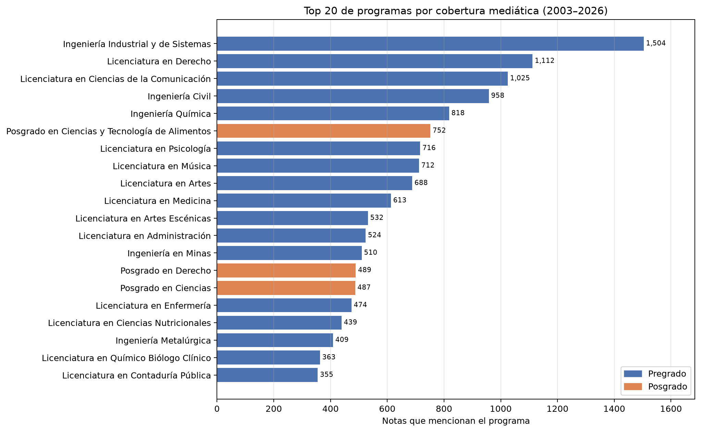
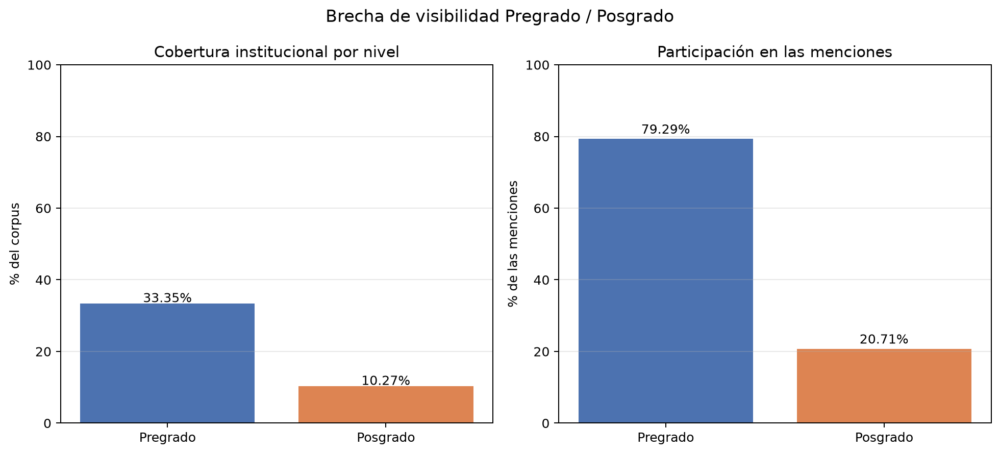
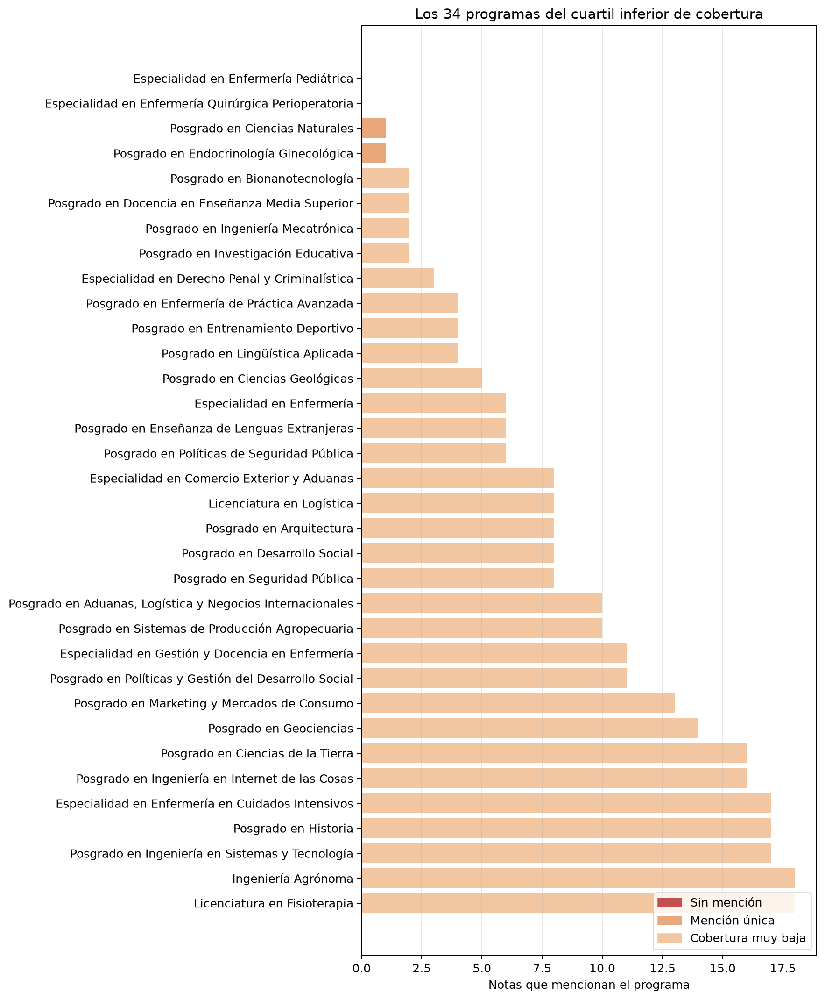
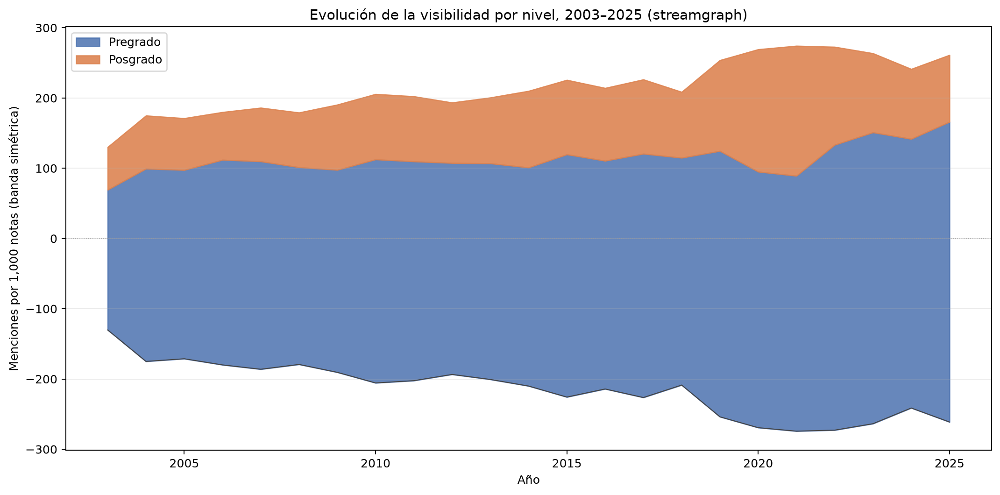
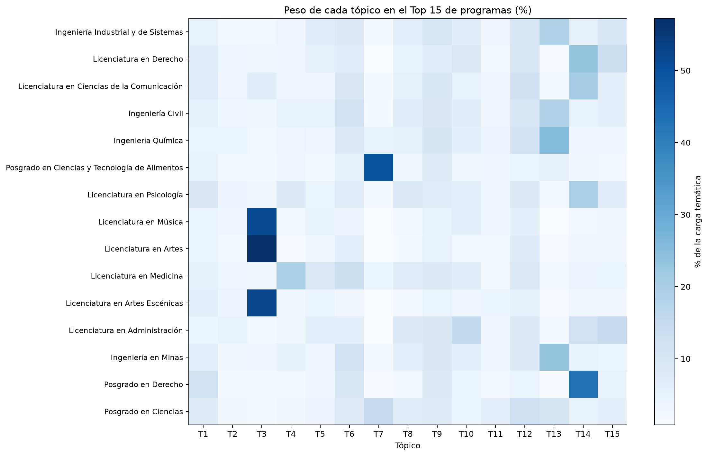
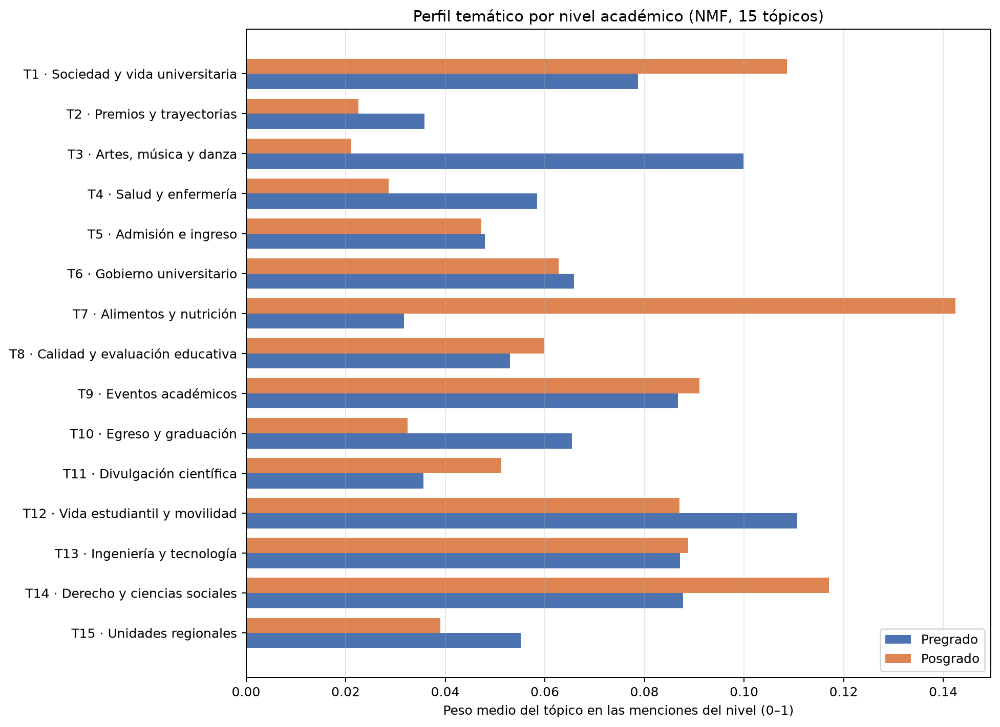
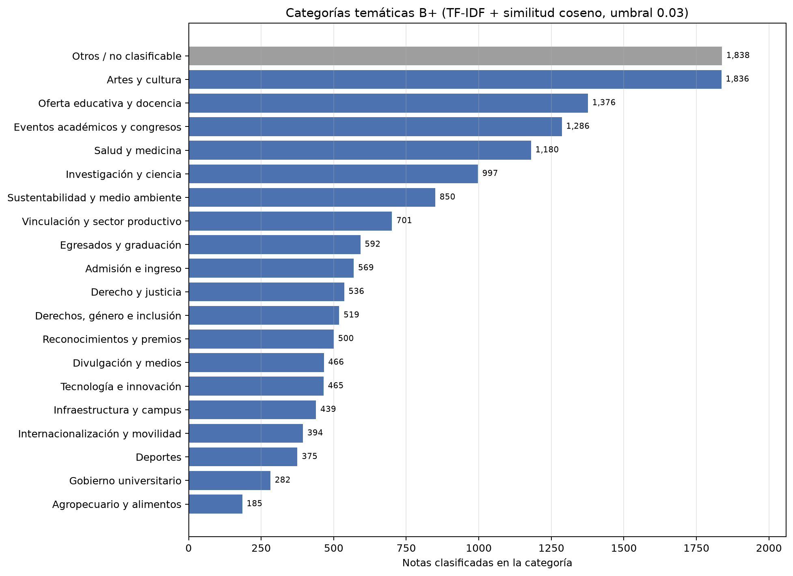

# De quién habla la UNISON

## Narrativa en tres actos sobre la cobertura mediática institucional (2003–2026)

**Fuente:** [https://www.unison.mx/noticias-anteriores/](https://www.unison.mx/noticias-anteriores/)
**Corpus:** 37,975 registros crudos depurados; 37,882 notas internas (2003–2026) con 37,882 cuerpos completos.
**Menciones:** 22,403 en 15,386 notas con al menos un programa (40.62%).
**Programas observados:** 129 de 131 del catálogo canónico.
**Capa temática B+:** 13,548 de 15,386 notas (88.05%) con categoría asignada.
**Artefactos:** `data/processed/` (Fases 2–3) y `reports/figures/` (Fase 4).
**Script de figuras:** `src/data/fase4_narrativa.py`.

---

## Resumen ejecutivo

La cobertura mediática de la UNISON no es un espejo neutral de su oferta académica: es un
relato con protagonistas estables, ausencias sistemáticas y temas recurrentes. Este reporte
organiza la evidencia en tres actos:

1. **El estatus quo:** el Pregrado concentra el micrófono. El Top 20 acumula **60.17%** de las
   menciones y el Gini de concentración es **0.661**. La brecha de participación es de
   **58.58 puntos porcentuales** (79.29% Pregrado vs. 20.71% Posgrado).
2. **La evolución:** la cobertura crece en ambos niveles, pero el reparto no cambia. La agenda
   se desplaza de las artes y la ingeniería tradicional hacia música, psicología, enfermería y
   ciencias de la salud, sin que el Posgrado deje de ser minoría.
3. **El discurso:** cada área se proyecta con un repertorio temático reconocible. Derecho habla
   en clave jurídica; Artes y Música, en clave cultural; Alimentos, en clave agroalimentaria;
   las ingenierías comparten un lenguaje técnico-industrial. La capa B+ confirma estos marcos
   con una taxonomía fija de 19 categorías más `Otros`.

**Hallazgo central:** el "olvido mediático" no es un accidente de baja frecuencia: es un patrón
estructural. **31 de los 34 programas del cuartil inferior son de Posgrado**; dos
especialidades no recibieron una sola mención en 23 años.

---

## Nota metodológica

- **Unidad de análisis:** la mención (`Enlace`, `Programa`) extraída del título y del cuerpo de
  la nota. Una nota puede mencionar varios programas; el mismo programa cuenta una sola vez por
  nota. Las listas coordinadas ("Psicología y Comunicación") se separan en programas
  independientes cuando cada parte resuelve contra el catálogo.
- **Catálogo:** 131 programas. Maestría y doctorado de un mismo campo se agrupan en una sola
  entrada `Posgrado en X`; las especialidades conservan su entrada propia. "Ingeniería
  Industrial" se resuelve a "Ingeniería Industrial y de Sistemas".
- **Cobertura:** porcentaje de las 37,882 notas del corpus que mencionan al menos una vez al
  programa. **Participación:** porcentaje de las 22,403 menciones que corresponden a un nivel
  o programa. Ambas métricas se reportan por separado porque no son intercambiables.
- **Evolución:** notas únicas con mención del nivel por cada 1,000 notas del periodo. Se
  excluye 2026 por ser año parcial (el corpus termina en octubre).
- **Tópicos (descubrimiento):** NMF sobre TF-IDF (15 componentes, semilla `20261103`). El
  tópico principal de un programa es el de mayor carga acumulada; se reporta también el top-3
  y la coherencia NPMI media.
- **Categorías B+ (clasificación):** taxonomía fija de 19 categorías descritas con vocabulario
  controlado, más `Otros / no clasificable`. Se compara el TF-IDF de cada nota contra las
  descripciones por similitud coseno; si la similitud máxima no alcanza 0.03, la nota cae en
  `Otros`. Se persiste la categoría principal y el top-3.
- **Lectura causal:** este es un análisis descriptivo de agenda editorial. No permite inferir
  intención institucional ni impacto social; solo documenta qué se publicó.

---

# Acto I — El estatus quo: el micrófono tiene dueño

## 1.1. Los programas que acaparan la conversación



| # | Programa | Nivel | Notas | % de las menciones |
|---:|---|---|---:|---:|
| 1 | Ingeniería Industrial y de Sistemas | Pregrado | 1,504 | 6.71% |
| 2 | Licenciatura en Derecho | Pregrado | 1,112 | 4.96% |
| 3 | Licenciatura en Ciencias de la Comunicación | Pregrado | 1,025 | 4.58% |
| 4 | Ingeniería Civil | Pregrado | 958 | 4.28% |
| 5 | Ingeniería Química | Pregrado | 818 | 3.65% |
| 6 | Posgrado en Ciencias y Tecnología de Alimentos | Posgrado | 752 | 3.36% |
| 7 | Licenciatura en Psicología | Pregrado | 716 | 3.20% |
| 8 | Licenciatura en Música | Pregrado | 712 | 3.18% |
| 9 | Licenciatura en Artes | Pregrado | 688 | 3.07% |
| 10 | Licenciatura en Medicina | Pregrado | 613 | 2.74% |
| 11 | Licenciatura en Artes Escénicas | Pregrado | 532 | 2.37% |
| 12 | Licenciatura en Administración | Pregrado | 524 | 2.34% |
| 13 | Ingeniería en Minas | Pregrado | 510 | 2.28% |
| 14 | Posgrado en Derecho | Posgrado | 489 | 2.18% |
| 15 | Posgrado en Ciencias | Posgrado | 487 | 2.17% |
| 16 | Licenciatura en Enfermería | Pregrado | 474 | 2.12% |
| 17 | Licenciatura en Ciencias Nutricionales | Pregrado | 439 | 1.96% |
| 18 | Ingeniería Metalúrgica | Pregrado | 409 | 1.83% |
| 19 | Licenciatura en Químico Biólogo Clínico | Pregrado | 363 | 1.62% |
| 20 | Licenciatura en Contaduría Pública | Pregrado | 355 | 1.58% |

**Lectura:** el Top 7 está formado por seis Pregrados y un solo Posgrado. El programa más
mencionado, Ingeniería Industrial y de Sistemas, aparece en 1,504 notas: **3.97% de todo el
corpus** y **6.71% de las menciones**. La concentración no es extrema en términos absolutos,
pero es persistente: el Top 20 acumula 60.17% de las menciones, el Top 50 llega a 87.88% y el
Gini es 0.661.

## 1.2. La brecha Pregrado / Posgrado



| Grupo | Programas | Activos | Notas | Cobertura institucional | Menciones | Participación |
|---|---:|---:|---:|---:|---:|---:|
| Pregrado | 61 | 61 | 12,633 | **33.35%** | 17,763 | **79.29%** |
| Posgrado | 70 | 68 | 3,889 | **10.27%** | 4,640 | **20.71%** |

- **Brecha de participación:** +58.58 puntos porcentuales a favor del Pregrado.
- **Brecha de cobertura:** +23.08 puntos porcentuales (33.35% vs. 10.27%).
- **Razón de cobertura:** 3.25 notas de Pregrado por cada nota de Posgrado.
- **Promedio por programa activo:** 291.2 notas (Pregrado) vs. 68.2 (Posgrado).
- **Mediana:** 205 vs. 26 notas.

**Lectura:** la brecha no se explica solo porque el catálogo de Posgrado sea más grande (70
programas vs. 61). Incluso entre programas activos, el Pregrado recibe en promedio más de
cuatro veces notas. El Posgrado tiene 68 programas activos, pero solo tres aparecen en el
Top 20.

## 1.3. El olvido mediático



El cuartil inferior de cobertura (≤ 18 notas) está formado por **34 programas** (26.0% del
catálogo). Su composición es reveladora:

| Categoría | Programas | Posgrado | Pregrado |
|---|---:|---:|---:|
| Sin mención | 2 | 2 | 0 |
| Mención única | 2 | 2 | 0 |
| Cobertura muy baja | 30 | 27 | 3 |
| **Total** | **34** | **31** | **3** |

**Los dos programas sin ninguna mención:**

- Especialidad en Enfermería Pediátrica
- Especialidad en Enfermería Quirúrgica Perioperatoria

**Excepciones de Pregrado en el cuartil inferior:** Licenciatura en Logística (8 notas),
Ingeniería Agrónoma (18) y Licenciatura en Fisioterapia (18).

**Lectura:** el olvido es casi un monopolio del Posgrado. La visibilidad no se hereda entre
niveles ni entre programas de la misma área: mientras el `Posgrado en Ciencias y Tecnología de
Alimentos` es el sexto programa más mencionado (752 notas), otras familias de posgrado con
menos tradición mediática permanecen en el cuartil inferior.

---

# Acto II — La evolución: de la ingeniería a la escena

## 2.1. Una cobertura que crece, pero no se reparte



| Década | Pregrado | Posgrado | Brecha (pp) | Notas del periodo |
|---|---:|---:|---:|---:|
| 2000s | 280.04 | 77.26 | 202.78 | 8,931 |
| 2010s | 327.19 | 101.57 | 225.63 | 19,652 |
| 2020s* | 398.11 | 129.37 | 268.74 | 9,299 |

\* Década parcial (2020–octubre 2026). Tasas = notas únicas del nivel por 1,000 notas del periodo.

**Lectura:** ambos niveles ganan visibilidad relativa, pero la brecha **se amplía** en términos
absolutos: de 203 a 269 notas por 1,000. El Pregrado parte de una base 3.6 veces mayor y crece
más rápido en volumen. No hay evidencia de convergencia.

## 2.2. Los picos de cada nivel

| Nivel | Año pico (completo) | Notas | Notas por 1,000 |
|---|---|---|---:|
| Pregrado | 2025 | 561 | 427.27 |
| Posgrado | 2021 | 252 | 185.02 |

- El Pregrado alcanza su máximo en **2025**, el último año completo del corpus.
- El Posgrado alcanza su máximo en **2021**, año de recuperación de actividad tras la
  pandemia, y no vuelve a ese nivel en 2022–2025.
- En 2020, el volumen absoluto de notas de Pregrado cae, aunque la tasa relativa se mantiene.
  La pandemia contrae el archivo, no la proporción de la agenda.

## 2.3. El cambio de agenda, década a década

**Top 6 por número de menciones:**

| Década | Programas líderes (menciones) |
|---|---|
| 2000s | Artes (406), Industrial y de Sistemas (340), Comunicación (264), Derecho (241), Civil (241), Química (201) |
| 2010s | Industrial y de Sistemas (825), Derecho (552), Comunicación (508), Civil (464), Posgrado CyTA (432), Química (404) |
| 2020s | Industrial y de Sistemas (339), Derecho (319), Música (283), Psicología (277), Comunicación (253), Civil (253) |

**Trayectorias que cuentan una historia (menciones por década):**

| Programa | 2000s | 2010s | 2020s* | Interpretación |
|---|---:|---:|---:|---|
| Licenciatura en Artes | 406 | 233 | 49 | declive editorial fuerte |
| Licenciatura en Música | 27 | 402 | 283 | irrupción y consolidación |
| Licenciatura en Enfermería | 67 | 199 | 208 | crecimiento sostenido |
| Licenciatura en Psicología | 109 | 330 | 277 | consolidación en la agenda |
| Posgrado en CyT de Alimentos | 116 | 432 | 204 | auge y normalización |
| Licenciatura en Derecho | 241 | 552 | 319 | liderazgo estable |
| Ingeniería Civil | 241 | 464 | 253 | base estructural |
| Ingeniería Química | 201 | 404 | 213 | base estructural |

\* Década parcial; los valores no son comparables en volumen absoluto con décadas completas.

**Lectura narrativa:** en los 2000s, el relato institucional se organiza alrededor de las artes
y la ingeniería tradicional. En los 2010s, Derecho y las ingenierías industriales toman el
centro, con la irrupción de Alimentos. En los 2020s, la agenda se diversifica hacia música,
psicología, enfermería y artes escénicas, mientras las ingenierías y Derecho conservan una base
estructural. **No es una sustitución, sino una ampliación del repertorio:** el Pregrado sigue
dominando, pero el tipo de Pregrado que aparece cambia.

---

# Acto III — El discurso: cómo se proyecta cada área

## 3.1. Quince temas para contar la Universidad

Modelo NMF/TF-IDF sobre 22,403 menciones. Los tópicos no son "temas" esenciales de los
programas, sino **contextos discursivos** en los que aparecen. La coherencia NPMI media es
**0.244** y la diversidad de términos, 0.95.

| Tema | Etiqueta | Palabras clave | Coherencia NPMI | Programas con ese tópico principal |
|---:|---|---|---:|---:|
| 1 | Sociedad y vida universitaria | ser / vida / cómo / rubio / sociedad / mujeres | 0.069 | 3 |
| 2 | Premios y trayectorias | premio / trayectoria / estudiantil / rectora / 2023 / maría | 0.270 | 2 |
| 3 | Artes, música y danza | artes / música / danza / bellas / teatro / obra | 0.339 | 4 |
| 4 | Salud y enfermería | salud / enfermería / medicina / módulos / atención | 0.245 | 7 |
| 5 | Admisión e ingreso | aspirantes / ingreso / examen / convocatoria / registro | 0.393 | 9 |
| 6 | Gobierno universitario | rector / ortega / romero / grijalva / monteverde | 0.350 | 5 |
| 7 | Alimentos y nutrición | alimentos / dipa / alimentación / radio / tiempo | 0.310 | 7 |
| 8 | Calidad y evaluación educativa | acreditación / evaluación / calidad / consejo / educación | 0.273 | 5 |
| 9 | Eventos académicos | evento / conferencias / actividades / congreso / semana | 0.161 | 11 |
| 10 | Egreso y graduación | ceremonia / egresados / generación / graduantes / pasante | 0.326 | 5 |
| 11 | Divulgación científica | feria / biociencias / 12 / 13 / biológicas / dirección | 0.109 | 9 |
| 12 | Vida estudiantil y movilidad | semestre / física / concurso / segundo / movilidad / deporte | 0.087 | 10 |
| 13 | Ingeniería y tecnología | industrial / química / sistemas / materiales / civil | 0.230 | 26 |
| 14 | Derecho y ciencias sociales | derecho / curso / comunicación / sociales / psicología | 0.131 | 22 |
| 15 | Unidades regionales | unidad / regional / norte / caborca / urn / sur | 0.360 | 4 |

**Lectura:** la Universidad se cuenta, sobre todo, a través del **lenguaje técnico-industrial
(T13, 26 programas)** y de **derecho y ciencias sociales (T14, 22)**. El tercer bloque es
**eventos académicos (T9, 11)**, señal de que la agenda editorial está vinculada a ciclos
institucionales. Los temas de mayor especialización —artes, alimentos, salud— agrupan a pocos
programas pero con pesos muy altos.

## 3.2. El tópico principal de los programas más visibles

| Programa | Nivel | Notas | Tópico principal | Peso |
|---|---|---|---:|---:|
| Ingeniería Industrial y de Sistemas | Pregrado | 1,504 | Ingeniería y tecnología | 19.00% |
| Licenciatura en Derecho | Pregrado | 1,112 | Derecho y ciencias sociales | 23.11% |
| Licenciatura en Ciencias de la Comunicación | Pregrado | 1,025 | Derecho y ciencias sociales | 20.29% |
| Ingeniería Civil | Pregrado | 958 | Ingeniería y tecnología | 18.65% |
| Ingeniería Química | Pregrado | 818 | Ingeniería y tecnología | 25.68% |
| Posgrado en Ciencias y Tecnología de Alimentos | Posgrado | 752 | Alimentos y nutrición | **49.70%** |
| Licenciatura en Psicología | Pregrado | 716 | Derecho y ciencias sociales | 19.42% |
| Licenciatura en Música | Pregrado | 712 | Artes, música y danza | **51.32%** |
| Licenciatura en Artes | Pregrado | 688 | Artes, música y danza | **57.25%** |
| Licenciatura en Medicina | Pregrado | 613 | Salud y enfermería | 19.39% |
| Licenciatura en Artes Escénicas | Pregrado | 532 | Artes, música y danza | **52.49%** |
| Licenciatura en Administración | Pregrado | 524 | Egreso y graduación | 15.14% |



**Lecturas:**

1. **Derecho** no solo es uno de los más mencionados: su discurso está especializado en lo
   jurídico-social (23.1% en Pregrado y 46.0% en Posgrado). Es el programa con la narrativa más
   nítida entre los grandes.
2. **Artes y Música** son los casos de mayor especialización del Pregrado (51.3–57.3%): la
   cultura es su marco casi exclusivo.
3. **Alimentos (Posgrado)** es el programa más especializado del corpus (49.7%) y el único
   Posgrado del Top 7. Su visibilidad se sostiene en un tema propio, no en eventos genéricos.
4. **Ingenierías** comparten el tópico técnico-industrial (18.7–25.7%), lo que sugiere una
   narrativa común de proyectos, materiales y sistemas. Su peso moderado indica que también
   reciben cobertura de eventos, ingreso y graduación.
5. **Comunicación (20.3%) y Psicología (19.4%)** comparten el marco jurídico-social sin un
   tópico propio: aparecen en muchos contextos, pero sin un marco temático dominante. Es
   visibilidad de agenda, no de especialidad.

## 3.3. Perfil temático por nivel



| Tema | Pregrado | Posgrado | Sesgo |
|---|---:|---:|---|
| 1. Sociedad y vida universitaria | 0.08 | **0.11** | Posgrado |
| 2. Premios y trayectorias | **0.04** | 0.02 | Pregrado |
| 3. Artes, música y danza | **0.10** | 0.02 | Pregrado |
| 4. Salud y enfermería | **0.06** | 0.03 | Pregrado |
| 5. Admisión e ingreso | 0.05 | 0.05 | Neutro |
| 6. Gobierno universitario | 0.07 | 0.06 | Pregrado |
| 7. Alimentos y nutrición | 0.03 | **0.14** | Posgrado |
| 8. Calidad y evaluación educativa | 0.05 | **0.06** | Posgrado |
| 9. Eventos académicos | 0.09 | 0.09 | Neutro |
| 10. Egreso y graduación | **0.07** | 0.03 | Pregrado |
| 11. Divulgación científica | 0.04 | **0.05** | Posgrado |
| 12. Vida estudiantil y movilidad | **0.11** | 0.09 | Pregrado |
| 13. Ingeniería y tecnología | 0.09 | 0.09 | Neutro |
| 14. Derecho y ciencias sociales | 0.09 | **0.12** | Posgrado |
| 15. Unidades regionales | **0.06** | 0.04 | Pregrado |

**Lecturas:**

- El **Posgrado** se proyecta con marcos de especialidad: **alimentos** (0.14 vs. 0.03, casi
  cinco veces más), **derecho/justicia** (0.12 vs. 0.09) y **sociedad/vida** (0.11 vs. 0.08).
- El **Pregrado** domina **artes** (0.10 vs. 0.02), **graduación** (0.07 vs. 0.03),
  **unidades regionales** (0.06 vs. 0.04) y **deporte/vida estudiantil** (0.11 vs. 0.09).
- **Eventos académicos** e **ingeniería y tecnología** son los temas más equilibrados: el
  lenguaje común de ambos niveles.
- El Posgrado no carece de discurso propio; lo que carece es **volumen**. Cuando aparece, lo
  hace con temas más especializados que el Pregrado.

## 3.4. Capa B+: categorías temáticas propuestas

La capa B+ clasifica cada nota contra una taxonomía fija de **19 categorías** descritas con
vocabulario controlado. No sustituye a NMF: NMF descubre temas, B+ verifica su presencia con
un marco estable y comparable entre notas, programas y niveles.



| Categoría | Notas | % |
|---|---:|---:|
| Otros / no clasificable | 1,838 | 11.95 |
| Artes y cultura | 1,836 | 11.93 |
| Oferta educativa y docencia | 1,376 | 8.94 |
| Eventos académicos y congresos | 1,286 | 8.36 |
| Salud y medicina | 1,180 | 7.67 |
| Investigación y ciencia | 997 | 6.48 |
| Sustentabilidad y medio ambiente | 850 | 5.52 |
| Vinculación y sector productivo | 701 | 4.56 |
| Egresados y graduación | 592 | 3.85 |
| Admisión e ingreso | 569 | 3.70 |
| Derecho y justicia | 536 | 3.48 |
| Derechos, género e inclusión | 519 | 3.37 |
| Reconocimientos y premios | 500 | 3.25 |
| Divulgación y medios | 466 | 3.03 |
| Tecnología e innovación | 465 | 3.02 |
| Infraestructura y campus | 439 | 2.85 |
| Internacionalización y movilidad | 394 | 2.56 |
| Deportes | 375 | 2.44 |
| Gobierno universitario | 282 | 1.83 |
| Agropecuario y alimentos | 185 | 1.20 |

**Categoría principal de los programas más visibles:**

| Programa | Nivel | Categoría principal | Peso | Menciones |
|---|---|---|---:|---:|
| Licenciatura en Artes | Pregrado | Artes y cultura | 72.53% | 499 |
| Licenciatura en Música | Pregrado | Artes y cultura | 66.01% | 470 |
| Licenciatura en Artes Escénicas | Pregrado | Artes y cultura | 61.09% | 325 |
| Licenciatura en Medicina | Pregrado | Salud y medicina | 48.29% | 296 |
| Licenciatura en Derecho | Pregrado | Derecho y justicia | 22.84% | 254 |
| Posgrado en Derecho | Posgrado | Derecho y justicia | 46.01% | 225 |
| Licenciatura en Enfermería | Pregrado | Salud y medicina | 46.62% | 221 |
| Licenciatura en Ciencias de la Comunicación | Pregrado | Divulgación y medios | 21.27% | 218 |
| Licenciatura en Artes Plásticas | Pregrado | Artes y cultura | 63.20% | 170 |
| Ingeniería Industrial y de Sistemas | Pregrado | Sustentabilidad y medio ambiente | 11.30% | 170 |
| Licenciatura en Ciencias Nutricionales | Pregrado | Salud y medicina | 37.59% | 165 |
| Posgrado en Ciencias y Tecnología de Alimentos | Posgrado | Investigación y ciencia | 21.01% | 158 |

**Lecturas:**

- **Artes y cultura** es la categoría más frecuente (11.93%) y absorbe más de la mitad de la
  carga de Artes, Música y Artes Escénicas.
- **Salud y medicina** distingue a Medicina, Enfermería y Nutrición, con pesos de 38–48%.
- **Investigación y ciencia** es la categoría principal del Posgrado (12.35% de sus menciones)
  y la del Posgrado en CyT de Alimentos (21.01%): el posgrado se cuenta como ciencia más que
  como docencia.
- **Otros** concentra 11.95% de las notas. No es ruido: reúne notas sin similitud suficiente
  con ninguna descripción, muchas de ellas de gestión cotidiana o de texto breve.

---

## Hallazgos principales

1. **La concentración es alta y estable.** Top 20 = 60.17% de las menciones; Gini = 0.661.
   No es un fenómeno de un año ni de un programa: es la estructura del archivo.
2. **La brecha es de participación, no solo de cobertura.** El Pregrado recibe 79.29% de las
   menciones y el Posgrado 20.71%. La diferencia de 58.58 pp es el indicador más contundente.
3. **El olvido es estructural y casi exclusivamente de Posgrado.** 31 de 34 programas del
   cuartil inferior son de Posgrado; dos especialidades no tienen ninguna mención en 23 años.
4. **La visibilidad no se hereda.** Programas grandes de un área no arrastran a sus pares de
   posgrado: la familia de Alimentos es top 6, mientras otras familias permanecen en el cuartil
   inferior.
5. **La agenda se amplía, no se sustituye.** Música, Psicología y Enfermería crecen; las
   ingenierías y Derecho conservan su base. El cambio es de repertorio, no de hegemonía.
6. **Cada área tiene un discurso reconocible.** Derecho = jurídico-social; Artes/Música =
   cultural; Alimentos = agroalimentario; Ingenierías = técnico-industrial. Comunicación y
   Psicología son la excepción dispersa.
7. **B+ valida la lectura de NMF con un marco fijo.** Las categorías dominantes —artes,
   docencia, eventos, salud, investigación— coinciden con los tópicos de mayor peso, sin
   depender de una solución factorial particular.

---

## Implicaciones para la narrativa institucional

- **Diversificar no es solo publicar más:** los datos muestran que ciertos Posgrados
  (Alimentos, Derecho) ya tienen un relato nítido; el problema es la ausencia de los otros.
- **El "olvido" tiene nombres y apellidos:** dos especialidades sin mención y 31 programas en
  el cuartil inferior son un punto de partida concreto para una estrategia editorial.
- **La agenda de ingreso y eventos funciona como lenguaje común:** es el puente natural para
  incorporar programas con baja cobertura sin inventar temas nuevos.
- **La brecha no se corrige con notas genéricas:** la evidencia sugiere que los programas
  visibles tienen temas propios; los invisibles necesitan un marco temático, no solo presencia.

---

## Limitaciones

- **Mención ≠ programa:** el tópico describe la nota en que aparece el programa, no su esencia.
  Una nota puede tratar otro tema y mencionarlo de pasada.
- **Tópico principal ≠ tópico único:** los pesos son participaciones sobre 15 temas; valores de
  13–26% indican cobertura dispersa, no ausencia de tema.
- **Vocabulario sin lematización ni NER:** quedan nombres propios y variantes en las palabras
  clave (p. ej. "rubio", "ortega"); los tópicos 1 y 6 son esencialmente cobertura de sociedad y
  rectoría y no deben leerse como áreas de conocimiento.
- **Departamento como proxy:** expresiones como "Departamento de Ingeniería Civil y Minas" se
  contabilizan como mención del programa.
- **Umbral B+:** 0.03 es una decisión operativa; un umbral más alto reduciría la cobertura y
  aumentaría `Otros`; uno más bajo asignaría categorías a notas de similitud débil.
- **2020s y 2026 son parciales:** no se usan para conclusiones de tendencia en volumen.
- **Diseño descriptivo:** no identifica causas ni intención editorial; solo documenta patrones
  de publicación.

---

## Reproducibilidad

```powershell
# Fase 2 (cobertura, brecha, olvido, evolución)
uv run python -X utf8 src/data/fase2_cobertura_brecha.py `
  --input data/interim/noticias_limpias_full.parquet `
  --corpus data/interim/corpus_analisis.parquet

# Fase 3 (tópicos NMF)
uv run python -X utf8 src/data/fase3_topicos.py

# Fase 3 (capa B+ de categorías)
uv run python -X utf8 src/data/fase3_taxonomia.py

# Fase 4 (figuras de esta narrativa)
uv run python -X utf8 src/data/fase4_narrativa.py

# Verificación
uv run ruff check .
uv run pytest -q
```

### Código sugerido para los dos gráficos clave

**Barras horizontales (Top 20, coloreadas por nivel):**

```python
import matplotlib.pyplot as plt

top = cobertura.head(20).sort_values("Notas")
colores = top["Grupo"].map({"Pregrado": "#4c72b0", "Posgrado": "#dd8452"})
fig, ax = plt.subplots(figsize=(10, 8))
ax.barh(top["Programa"], top["Notas"], color=colores)
ax.set_xlabel("Notas que mencionan el programa")
ax.set_title("Top 20 de programas por cobertura mediática (2003–2026)")
ax.grid(axis="x", alpha=0.3)
fig.tight_layout()
```

**Streamgraph (evolución por nivel):**

```python
anios = evolucion[
    (evolucion["Periodo_Tipo"] == "Año") & (~evolucion["Es_Periodo_Parcial"])
]
pivote = anios.pivot(index="Periodo", columns="Grupo", values="Notas por 1000").sort_index()
pregrado, posgrado = pivote["Pregrado"].to_numpy(), pivote["Posgrado"].to_numpy()
base = -(pregrado + posgrado) / 2
fig, ax = plt.subplots(figsize=(12, 6))
ax.fill_between(pivote.index, base, base + pregrado, label="Pregrado", color="#4c72b0")
ax.fill_between(pivote.index, base + pregrado, base + pregrado + posgrado,
                label="Posgrado", color="#dd8452")
ax.axhline(0, color="#999999", linewidth=0.6, linestyle=":")
ax.legend()
fig.tight_layout()
```

El código completo, con las siete figuras y sus etiquetas, está en
`src/data/fase4_narrativa.py`.

---

## Siguiente paso

Este reporte cierra la Fase 4. Queda pendiente:

1. Validar la narrativa y las figuras (Punto de Control 4).
2. Si se aprueba, regenerar el snapshot con `reports/fase4_narrativa.md` y las figuras.
3. Redactar el resumen ejecutivo final / conclusiones del proyecto.
4. Cerrar la entrega con la libreta `notebooks/07_historia.ipynb`, que resume el
   recorrido del pipeline y la historia narrada.
